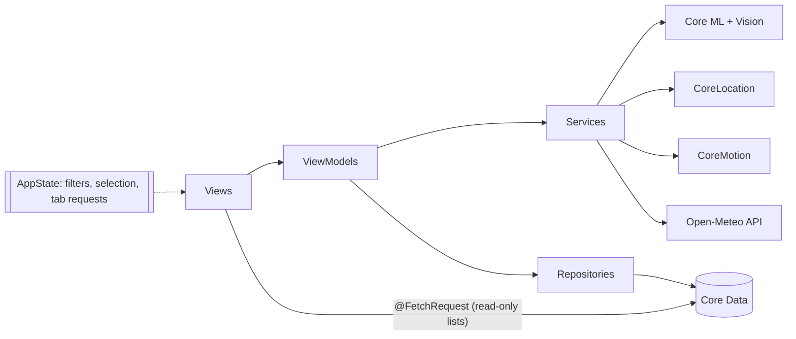
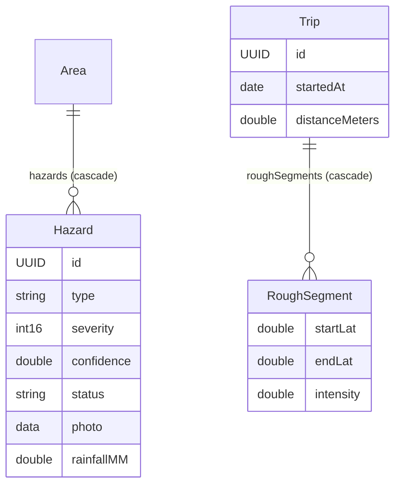

# RoadPulse – AI Road Hazard Mapper

SwiftUI iOS app for the Honours course **iOS Application Development using SwiftUI (216H05C701)**.
Photograph a road hazard, let an on-device Core ML model check it, and RoadPulse geotags it, stores it in Core Data and shows it on a map. An optional Drive Mode maps rough roads from the phone's motion sensors.

- iOS 17+, Swift 5.9, SwiftUI-first, Apple frameworks only (no third-party packages).
- Everything runs on the device except one call: Open-Meteo for the last 7 days of rainfall (no API key).

## Features

| | |
|---|---|
| **Map** | Custom severity pins (grey when fixed, pulsing when severe), filter chips, place search, hazard sheet with directions, mark fixed and delete, coloured Drive Mode trail. |
| **Report** | Camera or photo library → Core ML classifier with a confidence ring → details (severity, type, notes, address, signboard OCR landmark) → saved in the background. |
| **Hazards** | Sectioned list by area or photo gallery (the thumbnail morphs between them), search, swipe to resolve or delete, long-press preview, severity index strip, pinch-zoom detail with edit and share. |
| **Weather** | Open-Meteo rainfall for each hazard (async/await and Combine versions), monsoon risk badge, loading / error / retry. |
| **Insights** | Hand-drawn bar chart, severity donut, stat cards and "worst roads near me". All built from `Path` and `Shape`, no chart library. |
| **Drive Mode** | Hold to start, 50 Hz CoreMotion, live waveform, rough stretches saved to a trip and drawn on the map. "Replay sample drive" works on the simulator. |
| **Settings** | Map style, default severity filter, units, haptics, Drive threshold, demo data, delete all, replay intro. |

Design is documented in [docs/DESIGN.md](docs/DESIGN.md) (asphalt-and-lane-paint theme, dashed lane line as the signature motif, light and dark mode, Dynamic Type, VoiceOver labels, Reduce Motion fallbacks).

## Architecture

MVVM + repository. Views stay thin, view models (`ObservableObject` + `@Published`) own screen logic, services wrap Apple frameworks, repositories own Core Data. Full detail in [docs/ARCHITECTURE.md](docs/ARCHITECTURE.md).





The Core Data model is built in code (`ModelBuilder`), not in an `.xcdatamodeld`.

## ML model

MobileNetV3-Small fine-tuned in PyTorch (`ml/train.py`) and converted with coremltools (`ml/convert.py`) to `RoadClassifier.mlpackage`.

| | |
|---|---|
| Classes | normal, pothole |
| Test accuracy | **96.7%** on 211 held-out images |
| Pothole recall / precision | 95.3% / 99.2% |
| Split | 80/10/10 grouped by source photo, so augmented copies never cross splits |

Full confusion matrix, data sources and caveats (public Hugging Face datasets, no crack class) are in [ml/REPORT.md](ml/REPORT.md). Datasets and checkpoints are git-ignored.

## Build and run

The project file is generated, never committed.

```bash
brew install xcodegen
xcodegen generate && open RoadPulse.xcodeproj   # then run on an iOS 17+ simulator or device
```

`project.yml` is the source of truth for targets, Info.plist keys and build settings. CI (`.github/workflows/ios.yml`) generates the project, builds and runs the XCTests on a macOS runner on every push.

### Moving the blue dot (GPX)

The simulator has no GPS. To see the map follow a route:

1. Run the app on a simulator.
2. In Xcode choose **Debug → Simulate Location → MumbaiCommute**.

`RoadPulse/Resources/MumbaiCommute.gpx` is a simulated Kalyan → Thane → Ghatkopar commute (151 waypoints, 3 s apart). Without a location the Report flow's Review button stays disabled by design. You can also use **Features → Location → Custom Location** in the simulator.

### Drive Mode on the simulator

The simulator has no motion sensors. Open the car button on the Map and tap **Replay sample drive**: it plays `sample_drive.csv` (90 s at 50 Hz with six rough patches) and leaves a coloured trail on the map. On a real device, hold the start button and drive.

## Screenshots

Added after the final run-through on the Mac: map, report flow, hazards (list and gallery), insights, drive mode, dark mode.

## Project docs

| | |
|---|---|
| [docs/PRD.md](docs/PRD.md) | Feature specs and acceptance criteria (F0–F9) |
| [docs/ARCHITECTURE.md](docs/ARCHITECTURE.md) | Folders, layers, data model, algorithms |
| [docs/DESIGN.md](docs/DESIGN.md) | Colours, type, spacing, motion, components |
| [docs/SYLLABUS_MAP.md](docs/SYLLABUS_MAP.md) | Every syllabus concept → the file that demonstrates it (checked by `DocsAuditTests`) |
| [docs/PROGRESS.md](docs/PROGRESS.md) | What was done, in order, with notes |
| [docs/MAC_SETUP_AND_DEMO.md](docs/MAC_SETUP_AND_DEMO.md) | Opening the project on a Mac, simulator checklist, running on an iPhone, demo script |

## Tests

XCTests cover repositories and queries, the classifier on held-out photos, OCR, the weather service (`URLProtocol` stub and JSON fixture), risk and severity maths, search, the report flow, hazards list logic, gesture maths, insights, the spike detector and Drive view model, plus a docs audit that fails if a syllabus row points at a missing file.
